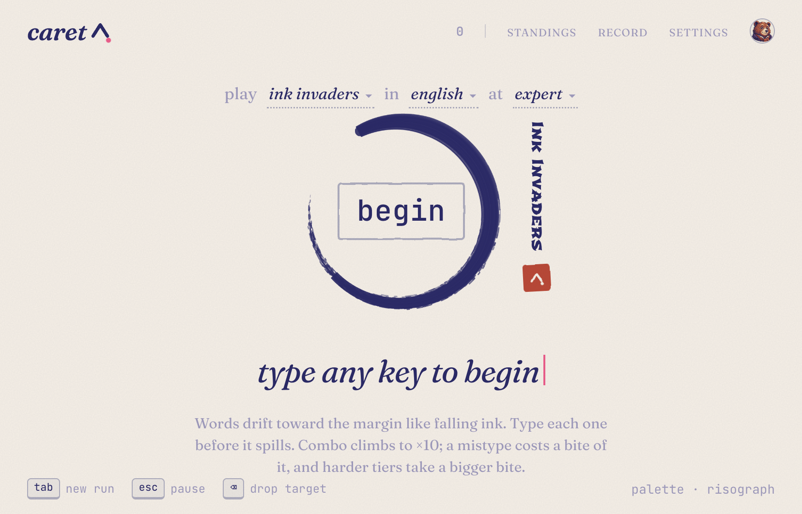
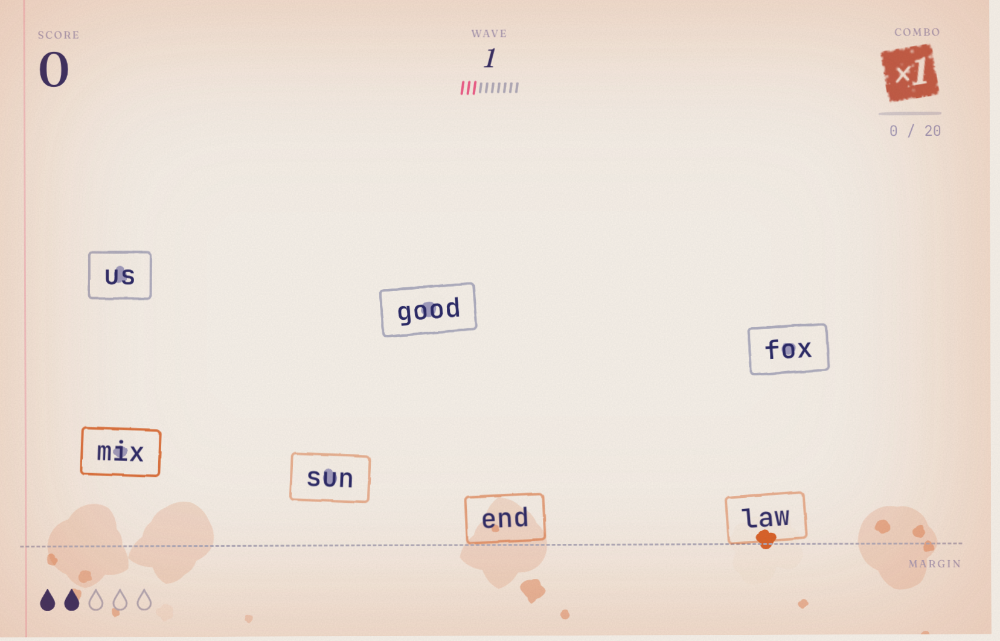

# caret — type in ink

Words drift down the page like falling ink. Type each one before it spills.



caret is a typing game with the look of paper and ink. There is no menu to click through. Open it, type any key, and a run starts. Words fall toward a margin at the bottom of the page. Type one out and it blots. Miss a letter and your combo takes a bite. Let a word reach the margin and you lose a drop of ink. Five spills and the page is full.



## How a run feels

The words are rubber stamps on paper. The one you are typing is the target; `@` drops it if you want another. Correct keys push that word a little back up the page. A mistype costs combo (more on harder difficulties). A spill costs the whole combo, and one of five ink drops.

Combo climbs from ×1 to ×10. Each new tier hits harder: more ink on a kill, a deeper thump, a red seal stamped over the multiplier, and ink blooming in from the edges of the page. At the top the page is loud.

When the run ends you get a hanging-scroll card: the score inside a brushed ensō, a three-line verse, and red seals if you set a personal best, kept a streak, or placed on the standings. Save it, share it, or press tab and go again.

`tab` is always a new run. `esc` pauses.

## What you type

Difficulty never picks the words. Easy through expert only change the pace, how crowded the page is, how far a key knocks a word back, and how much a mistype costs.

The words come from the language:

| | |
| --- | --- |
| **English** | short, common words |
| **English intermediate** | longer everyday words |
| **English advanced** | long and rare |
| **English punctuation** | capitals, commas, quotes |
| **Numbers** | digits |
| **JavaScript** / **Python** | keywords and syntax |
| **Thai** / **Thai intermediate** / **Thai punctuation** | the same idea, in Thai |

A run that a player of the chosen difficulty can just keep up with lasts about ten waves. After that the page asks for twice the speed every ten waves.

## Paper, ink, and a looping bed

Seven palettes, from warm paper to midnight ink to risograph pink. The particles, stains, seals and blooms all take their colour from the palette, so a kill on matcha is not a kill on blueprint.

Sound is synthesized: typewriter clacks that climb with combo, wet ink splats, a stamp on paper, a dull thud on a miss. A separate looping bed, *ink on water*, plays under a run and has its own volume. Effects and music never move each other.

## Keep a record

You can play as a guest. Runs stay on this device.

Sign in (Google, GitHub, Microsoft, Facebook, or email) and they travel with you. You get a daily streak, with a freeze earned every seven days. Your face is a drawing from a small set, or a picture you upload — cropped and resized to a square stamp. The standings keep a best score per language, difficulty and period (today, this week, all time). The record page is your calendar of days played, speed over time for the set you play most, and a list of personal bests.

Email accounts need a verified address before a run is posted.

## Play

Type any key.

Locally:

```sh
npm install
npm run dev
```

Then open the page and start typing.
